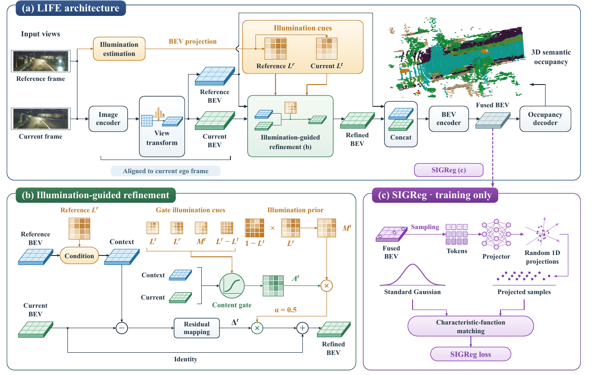
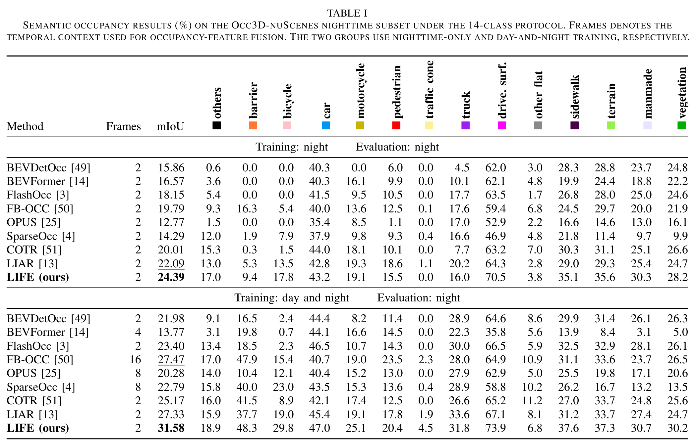
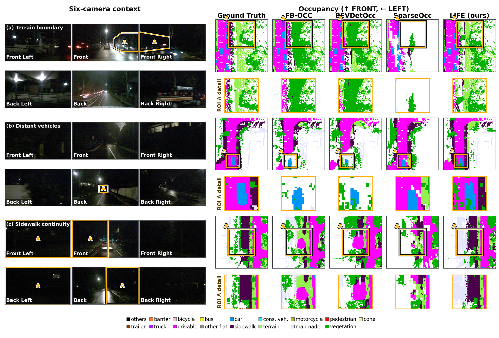

<h2 align="center">
  LIFE: Retaining What the Night Reveals for 3D Occupancy Prediction
</h2>

<p align="center">
  <a href="https://orcid.org/0000-0002-6098-7631">Pujun Liu</a><sup>1</sup>,
  <a href="https://orcid.org/0000-0003-2285-2469">Lulu Guo</a><sup>1</sup>,
  <a href="https://orcid.org/0000-0002-1312-0146">Yang Liu</a><sup>1</sup>,
  <a href="https://orcid.org/0000-0002-4365-4165">Jun Liu</a><sup>2</sup>,
  and <a href="https://orcid.org/0000-0002-1724-8649">Hong Chen</a><sup>1</sup>
</p>

<p align="center">
  <sup>1</sup>College of Electronic and Information Engineering, Tongji University<br>
  <sup>2</sup>School of Computing and Communications, Lancaster University
</p>

## Overview



**LIFE** (Light-guided Integration of Fleeting Evidence) uses illumination cues to
refine current BEV features with complementary historical observations.
SIGReg regularizes the fused features during training.

## Getting Started

- [Installation](docs/installation.md)
- [Data Preparation](docs/data.md)
- [Training and Evaluation](docs/usage.md)

## Main Results



| Training split | Weights |
|---|---|
| Day and night | [LIFE_FULL](https://github.com/Puzune/LIFE-weights/releases/download/v1.0/LIFE_FULL.pth) |
| Night only | [LIFE_NIGHT](https://github.com/Puzune/LIFE-weights/releases/download/v1.0/LIFE_NIGHT.pth) |

## Visualization



## Citation

```bibtex
@unpublished{liu2026life,
  title={LIFE: Retaining What the Night Reveals for 3D Occupancy Prediction},
  author={Liu, Pujun and Guo, Lulu and Liu, Yang and Liu, Jun and Chen, Hong},
  year={2026}
}
```

## License

LIFE-authored code is licensed under Apache-2.0. Third-party code retains its
original licenses, including non-commercial restrictions. See [LICENSE](LICENSE).

## Acknowledgements

We thank [OpenMMLab](https://github.com/open-mmlab/mmdetection3d),
[BEVDet](https://github.com/HuangJunJie2017/BEVDet),
[FlashOCC](https://github.com/Yzichen/FlashOCC),
[FB-BEV](https://github.com/NVlabs/FB-BEV),
[SCI](https://github.com/vis-opt-group/SCI),
[Occ3D](https://github.com/Tsinghua-MARS-Lab/Occ3D),
[DINOv3](https://github.com/facebookresearch/dinov3), and
[LeJEPA](https://github.com/galilai-group/lejepa).
